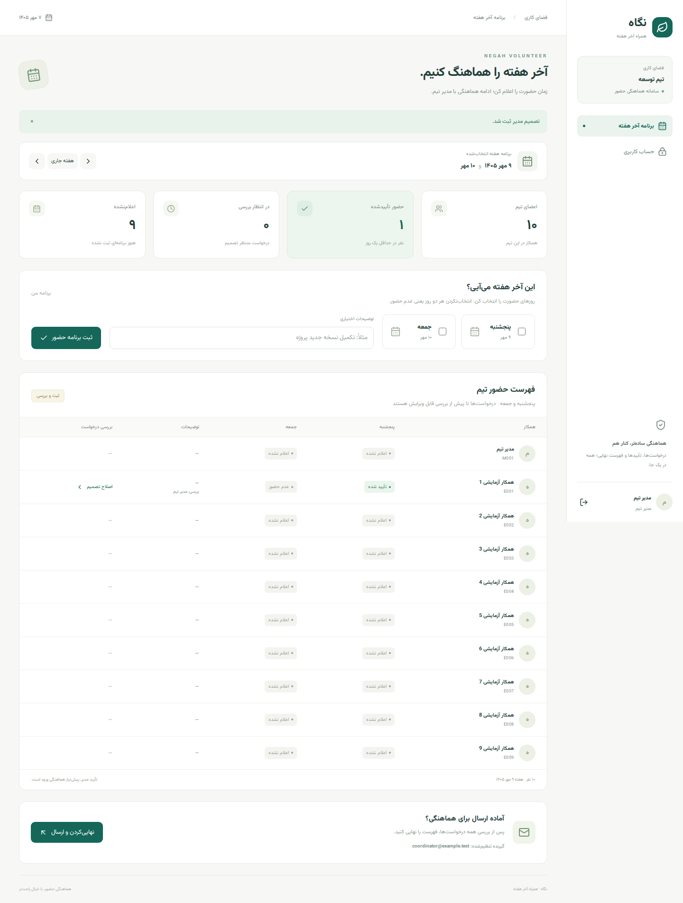

# نگاه | Negah Volunteer

سامانه فارسی هماهنگی حضور پنجشنبه و جمعه: ثبت برنامه توسط همکار، تأیید مستقل هر روز توسط مدیر، نهایی‌سازی فهرست و ایمیل به هماهنگ‌کننده.

## اجرای سریع روی سیستم خودتان

پیش‌نیاز: Docker Engine یا Docker Desktop و Docker Compose v2. اولین اجرا برای دریافت imageها و وابستگی‌ها اینترنت می‌خواهد؛ بعد از build، اجرای برنامه به CDN یا اینترنت وابسته نیست.

```bash
git clone https://github.com/aktoosi/negah-volunteer.git
cd negah-volunteer
cp .env.example .env
docker compose up --build -d
```

- برنامه: http://localhost:3000
- صندوق ایمیل آزمایشی Mailpit: http://localhost:8025
- مشاهده لاگ: `docker compose logs -f backend`
- توقف با حفظ اطلاعات: `docker compose down`
- حذف کامل اطلاعات فقط در صورت نیاز: `docker compose down -v`

### ورود آزمایشی

در حالت `DEMO_MODE=true`، اولین راه‌اندازی حساب‌های زیر را می‌سازد. رمز همه، مقدار `BOOTSTRAP_PASSWORD` در `.env` است؛ مقدار نمونه `LocalDemo-2026!` است.

| نام کاربری | نقش |
|---|---|
| `admin` | مدیر سیستم؛ تعریف تیم، گیرنده ایمیل و اعضا |
| `manager` | مدیر تیم |
| `member1` تا `member9` | اعضای آزمایشی |

تیم ده‌نفره شامل مدیر و ۹ عضو است؛ حساب admin عضو فهرست حضور نیست. داده‌های نمونه، اسامی واقعی کارکنان نیستند. Bootstrap فقط روی دیتابیس خالی اجرا می‌شود؛ تغییر متغیر رمز یا خاموش‌کردن دمو، حساب‌های قبلی را تغییر نمی‌دهد.

## سناریوی اولین استفاده

1. با `member1` وارد شوید. پنجشنبه یا جمعه را انتخاب و برنامه را ثبت کنید. هیچ انتخابی یعنی اعلام عدم حضور در هر دو روز.
2. خارج شوید و با `manager` وارد شوید. «بررسی» را بزنید، برای هر روز تصمیم بگیرید و ثبت کنید.
3. بعد از بررسی تمام درخواست‌های در انتظار، «نهایی‌کردن و ارسال» را بزنید. تعداد افراد اعلام‌نشده پیش از تأیید نهایی نمایش داده می‌شود.
4. فهرست قفل می‌شود؛ فایل CSV یا نسخه چاپی قابل دریافت است. worker ایمیل تقریباً هر ۱۵ ثانیه یک پیام صف‌شده را ارسال می‌کند.
5. در Mailpit محلی، متن واقعی ایمیل ساخته‌شده توسط بک‌اند را ببینید. پیش‌فرض توسعه هیچ ایمیلی به بیرون ارسال نمی‌کند.
6. با admin در «تیم‌ها و اعضا»، تیم موجود را انتخاب کنید و نام یا ایمیل هماهنگ‌کننده را ویرایش کنید؛ یا تیم و کاربر جدید بسازید.

## اتصال ایمیل شرکت

آدرس وب‌میل، آدرس SMTP نیست. میزبان SMTP، پورت، روش احراز هویت، حساب ارسال و مجوز دسترسی باید از IT گرفته شود. برنامه باید روی سیستمی در شبکه‌ای اجرا شود که به SMTP دسترسی دارد. رمز واقعی را در `.env` یا secret manager بگذارید، نه در GitHub.

```dotenv
DEMO_MODE=false
MAIL_ENABLED=true
SMTP_HOST=your-approved-smtp-host
SMTP_PORT=587
SMTP_AUTH=true
SMTP_STARTTLS=true
SMTP_USERNAME=service-account
SMTP_PASSWORD=your-secret
MAIL_FROM=your-approved-sender@company.example
COOKIE_SECURE=true
```

گیرنده از بخش مدیریت تیم تنظیم می‌شود. `.env.example` فقط تنظیمات آزمایشی دارد. TLS را مطابق تنظیمات IT برقرار کنید؛ نمونه بالا برای SMTP با STARTTLS است. برای SMTPS روی ۴۶۵ باید پیکربندی `spring.mail.properties.mail.smtp.ssl.enable` اضافه شود. احراز هویت OAuth اختصاصی Exchange در این نسخه پیاده نشده است.

برای شبکه شرکت، HTTPS و reverse proxy مورد تأیید IT لازم است و `COOKIE_SECURE=true` باید همراه HTTPS باشد. Compose پیش‌فرض فقط روی localhost گوش می‌دهد؛ برای دسترسی همکاران باید آدرس bind/پراکسی را مطابق شبکه استقرار تغییر دهید. قبل از بهره‌برداری، دیتابیس مستقل بدون داده دمو ایجاد کنید، رمزها را عوض کنید و ایمیل مقصد را تنظیم کنید.

## قواعد نسخه ۰٫۱

- شروع هفته عملیاتی پنجشنبه است؛ تاریخ API میلادی ISO و نمایش رابط شمسی است. محاسبه روز جاری با timezone تهران انجام می‌شود.
- ثبت و بررسی تا پایان همان پنجشنبه مجاز است؛ شروع هفته گذشته و بیش از ۱۲ هفته آینده قابل ثبت نیست. این مهلت فعلاً ثابت است.
- هر کاربر در هر هفته فقط یک درخواست دارد. ثبت مجدد قبل از بررسی، همان درخواست را ویرایش می‌کند.
- «اعلام نشده» با «عدم حضور» تفاوت دارد.
- مدیر تنها تیم خودش را می‌بیند؛ عضو فقط درخواست خودش را می‌بیند؛ admin همه تیم‌ها را مدیریت می‌کند.
- مدیر هم می‌تواند برای خودش ثبت درخواست و آن را بررسی کند. تأیید مدیر توسط مدیر بالادستی خارج از MVP است.
- بعد از ثبت تصمیم مدیر، کارمند نمی‌تواند درخواست را تغییر دهد؛ مدیر تا پیش از نهایی‌سازی می‌تواند تصمیم خود را اصلاح کند.
- نهایی‌سازی نیازمند حداقل یک روز تأییدشده و نبود درخواست در انتظار است. افراد اعلام‌نشده مانع نهایی‌سازی نیستند و در خروجی قرار نمی‌گیرند.
- فهرست نهایی قابل بازگشایی نیست. تغییر/ابطال بعد از ارسال و ایمیل اصلاحیه، توسعه بعدی است.
- تأیید مدیر یا موفقیت SMTP به معنی صدور مجوز ورود شرکت نیست. `SENT` یعنی سرور SMTP پیام را پذیرفته، نه اینکه شخص آن را خوانده است.
- وضعیت ایمیل مستقل از حضور است: `QUEUED → SENT / FAILED`؛ پس از خطا، مدیر تلاش مجدد را صریحاً انتخاب می‌کند.
- نهایی‌سازی و درج ایمیل در یک تراکنش هستند. متن و گیرنده ایمیل snapshot می‌شوند؛ تغییر ایمیل تیم، ایمیل قبلی را تغییر نمی‌دهد.
- صف پایدار است، اما SMTP تضمین exactly-once ندارد: خرابی بعد از پذیرش SMTP و قبل از commit می‌تواند باعث ارسال تکراری شود. شناسه ثابت فهرست داخل ایمیل درج می‌شود.
- ثبت آخرین بررسی‌کننده، زمان بررسی و نهایی‌کننده وجود دارد؛ گزارش کامل تمام ویرایش‌ها و audit trail جامع هنوز وجود ندارد.

## ساختار و تصمیم‌های فنی

- Java 17، Spring Boot 3.5.16، Spring Security، PostgreSQL، Flyway، Spring JDBC.
- React 19 + TypeScript + Vite، فارسی و RTL، فونت Vazirmatn محلی با مجوز OFL.
- نشست سروری با کوکی HttpOnly و SameSite، CSRF فعال، رمزهای BCrypt؛ توکن در localStorage نگهداری نمی‌شود.
- یک برنامه ساده با Controller → Service → JDBC؛ برای MVP از لایه‌ها و ماژول‌های اضافی اجتناب شده است.
- همه عملیات نوشتن برنامه حضور ابتدا ردیف تیم را `FOR UPDATE` قفل می‌کنند. این قفل فقط همان تیم را سریالی می‌کند و رقابت ثبت/بررسی/نهایی‌سازی را رفع می‌کند.
- SMTP در تراکنش جدا از عملیات حضور اجرا می‌شود. worker ردیف صف را با `SKIP LOCKED` می‌گیرد؛ timeout اتصال و ارسال ۵ ثانیه است.
- PostgreSQL و فایل‌های پروژه مستقل از خدمات اختصاصی میزبانی هستند.

## اجرای توسعه بدون Docker

یک PostgreSQL بسازید و متغیرهای `DB_URL`، `DB_USER`، `DB_PASSWORD` و `BOOTSTRAP_PASSWORD` را تنظیم کنید؛ برای داده دمو `DEMO_MODE=true` باشد. بدون SMTP، `MAIL_ENABLED=false` باقی بماند و ایمیل در صف می‌ماند.

```bash
cd backend
mvn spring-boot:run
```

در ترمینال دیگر، با Node 22:

```bash
cd frontend
npm ci
npm run dev
```

فرانت روی http://localhost:5173 است و درخواست‌های `/api` را به بک‌اند ۸۰۸۰ می‌فرستد.

## تست و build

```bash
cd backend
mvn verify
cd ../frontend
npm ci
npm run build
```

تست‌های محلی بک‌اند با H2 در حالت PostgreSQL اجرا می‌شوند. workflow گیت‌هاب همان تست‌ها را با PostgreSQL واقعی اجرا می‌کند. تست‌ها جداسازی تیم‌ها، کنترل نقش و CSRF، ورود، ویرایش تکرارپذیر، روز نامعتبر، قفل درخواست بررسی‌شده، ارسال ایمیل ناموفق/تلاش مجدد و نهایی‌سازی هم‌زمان را پوشش می‌دهند.

برای محیط عملیاتی، ورود SSO/LDAP، محدودسازی تلاش ورود، بازیابی رمز و غیرفعال‌سازی حساب، audit جامع، backup دیتابیس، پایش و مدیریت نشست چندنمونه‌ای باید پیش از گسترش سازمانی تکمیل شوند. نسخه فعلی MVP برای اجرای محلی و پایلوت کنترل‌شده است.

## API

تمام مسیرها جز health، csrf و login نیازمند نشست معتبر هستند. عملیات تغییردهنده به هدر CSRF دریافتی از `GET /api/csrf` نیاز دارند. login از `application/x-www-form-urlencoded` استفاده می‌کند؛ سایر بدنه‌ها JSON هستند.

| متد | مسیر | کاربرد |
|---|---|---|
| GET | `/api/health` | وضعیت برنامه |
| GET | `/api/csrf` | توکن و نام هدر CSRF |
| POST | `/api/login` | ورود با username/password |
| POST | `/api/logout` | خروج |
| GET | `/api/me` | پروفایل |
| PUT | `/api/me/password` | تغییر رمز |
| GET/POST | `/api/teams` | تیم‌های مجاز / ایجاد تیم |
| PUT | `/api/teams/{teamId}` | ویرایش نام و گیرنده تیم |
| POST | `/api/users` | ایجاد حساب |
| GET | `/api/teams/{teamId}/weeks/{thursday}` | وضعیت هفته |
| PUT | `/api/me/weeks/{thursday}` | ثبت/ویرایش برنامه |
| PUT | `/api/teams/{teamId}/weeks/{thursday}/requests/{requestId}` | بررسی هر دو روز |
| POST | `/api/teams/{teamId}/weeks/{thursday}/finalize` | نهایی‌سازی و صف ایمیل |
| POST | `/api/teams/{teamId}/weeks/{thursday}/retry-email` | تلاش مجدد خطای ایمیل |
| GET | `/api/teams/{teamId}/weeks/{thursday}/export.csv` | خروجی تأییدشده نهایی |

نمونه ثبت: `{"thursday":true,"friday":false,"note":"تکمیل پروژه"}`

نمونه بررسی: `{"thursday":"APPROVED","friday":"NOT_ATTENDING","note":"تأیید شد"}`

## پیش‌نمایش



جزئیات تست‌های انجام‌شده و محدودیت محیط در [docs/VERIFICATION.md](docs/VERIFICATION.md) است.

اگر پروژه را به شکل ZIP دریافت کرده‌اید و مخزن GitHub هنوز خالی است، بعد از استخراج می‌توانید با احراز هویت معمول Git خودتان آن را پوش کنید:

```bash
git init -b main
git add .
git commit -m "feat: initial Negah Volunteer MVP"
git remote add origin https://github.com/aktoosi/negah-volunteer.git
git push -u origin main
```

در صورت وجود فایل یا commit قبلی در مخزن، ابتدا clone و تغییرات را ادغام کنید؛ از force push استفاده نکنید.
